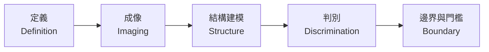

# llm-aoi-convergence

**以 LLM coding agent 接手並改造一套工業 AOI 機台程式：我從中學到的收斂方法。**
**Taking over and rebuilding an industrial AOI machine program with LLM coding agents — what I learned about making them converge.**

> 2026-11：成長整理 8 篇、迭代紀律通用版、可套用的範本與 skills、示意圖都已完成。
> Nov 2026: the eight growth notes, the generalized iteration discipline, reusable templates and skills, and the diagrams are all done.

---

## 專案概述 / Overview

2026 年 6 月到 11 月，我接手一套既有的工業 AOI（自動光學檢測）機台程式，把它改造成檢測新樣品：電極試片的外觀瑕疵，包括毛屑、貼合偏移、點藥填充不足、溢藥。系統是 C# WinForms＋OpenCV，搭配 PLC 與 6 台工業相機。從接手、研究、接入檢測線到交機，**程式碼全程由 LLM coding agent（Claude Code、Codex）產生**。

From June to November 2026 I took over an existing industrial AOI (automated optical inspection) machine program and rebuilt it to inspect a new product: cosmetic defects on electrode test strips (fibers, misalignment, insufficient reagent fill, reagent overflow). The stack is C# WinForms + OpenCV with a PLC and six industrial cameras. From takeover through research, line integration and handover, **all code was written by LLM coding agents (Claude Code and Codex)**.

## 我的角色 / My role

LLM 寫程式；我負責方向、瑕疵定義、拍板、驗證設計，以及約束 LLM 的規則。這個 repo 整理的就是後者：在真值模糊、要靠人覆核的視覺檢測裡，怎麼讓 LLM 的迭代真正收斂，而不是在開發集上越調越好看。

The agents wrote the code. I owned direction, defect definitions, sign-offs, verification design, and the rules that constrain the agents. This repo is about the latter: how to make LLM iterations actually converge in vision inspection where ground truth is fuzzy and humans do the review, instead of just looking better on the development set.

## 時間軸 / Timeline

| 期間 / Period | 階段 / Phase |
|---|---|
| 2026-06 | 接手：唯讀分析、建立 git 基準線、讓開發機能離線建置與執行 / Takeover: read-only analysis, git baseline, offline build and run |
| 2026-07 | 現代化：升級 .NET Framework 與 OpenCV 封裝庫、相機模擬器走完整生產管線 / Modernization: framework and OpenCV wrapper upgrade, camera simulator through the full production pipeline |
| 2026-07～08 | 第一批檢測線：研究→移植→接入、參數旋鈕化、逐位零迴歸；後因取像條件與範圍變更作廢 / First inspection lines with bit-exact regression; later invalidated by imaging and scope changes |
| 2026-09 | 上機：取像觸發電氣除錯、雙代理協作機制、檢測範圍重設、迭代紀律成形 / On-machine: trigger-line debugging, dual-agent protocol, scope reset, iteration discipline |
| 2026-10 | 新取像條件下三條檢測線接入、現場參數頁、客戶報表 / Three lines integrated under new imaging, on-site parameter page, reports |
| 2026-10～11 | 交機：穩健性、記憶體釋放、版本追溯、交接文件 / Handover: robustness, memory release, build traceability, handover docs |

## 收斂順序 / Convergence order

上游沒收斂時調下游參數，做的功是負的。 / Tuning downstream while upstream is unsettled is negative work.

## 成長重點 / Key takeaways

1. **要改的不是提示詞，是「什麼算完成」。** 完成與否由檔案（diff、分佈、封存集數字）裁定，不由 LLM 自述。
   *Change the definition of done, not the prompt wording. Files decide completion, not the agent's self-report.* → [02](growth/02_from_writing_code_to_converging.md)
2. **LLM 在基準失敗時會換更強的工具，而不是修失敗原因。** 方法選擇要在第零天由人在失敗圖上簽核。
   *When a baseline fails, an LLM tends to swap in a stronger tool instead of fixing the cause. A human should sign off the method on the failure images, on day zero.* → [03](growth/03_method_family_drift.md)
3. **每輪關掉一個開放問題，而不是改善一個數字。**
   *Each round should close one open question, not improve one number.* → [04](growth/04_two_images_vs_2m_tokens.md)
4. **多代理放大的是執行品質，不是方向正確性。**
   *Multi-agent runs amplify execution quality, not directional correctness.* → [04](growth/04_two_images_vs_2m_tokens.md)
5. **LLM 的眼睛要用在人前面，並留下可對答案的紀錄。**
   *Let the LLM look before the human does, and keep a record that can be scored against the human.* → [05](growth/05_human_in_the_loop.md)
6. **LLM 專案要有單一正本、可載入的程序知識、跨 session 記憶與明確的授權語義。**
   *An LLM project needs one source of truth, loadable procedures, cross-session memory and explicit authorization semantics.* → [07](growth/07_knowledge_architecture.md)

## 從哪裡讀起 / Where to start

時間不多就先讀 02（主線），再挑一篇案例（03 或 04）。
Short on time? Read 02 (the main thread), then one case study (03 or 04).

| 篇 / Note | 一句話 / In one line |
|---|---|
| [02 從「讓 LLM 寫程式」到「讓 LLM 收斂」](growth/02_from_writing_code_to_converging.md) | 主線：迭代紀律 v1～v7 各從哪一次失敗長出來 / The main thread: where each version of the iteration discipline came from |
| [03 方法族漂移](growth/03_method_family_drift.md) | LLM 自選 6 次方法，0 次留下 / The agent picked a method six times; none survived |
| [04 224 萬 token 被兩張圖推翻](growth/04_two_images_vs_2m_tokens.md) | 規則全守了還是走錯，缺的是階段閘門 / Every rule followed, still wrong: the missing stage gate |
| [05 人在迴路](growth/05_human_in_the_loop.md) | 我的判斷怎麼留下來，怎麼替 LLM 的眼睛打分數 / Keeping human verdicts, and scoring the agent's eyes |
| [06 取像條件與量測可信度](growth/06_imaging_domain_and_measurement_trust.md) | 常數屬於取像條件，不屬於演算法 / Constants belong to the imaging setup, not the algorithm |
| [07 LLM 專案的知識架構](growth/07_knowledge_architecture.md) | 單一正本、skills、跨 session 記憶、授權語義 / One source of truth, skills, memory, authorization |
| [01 接手遺留系統](growth/01_legacy_takeover.md) | 先唯讀、先建基準線、先確認哪一份是正本 / Read-only first, baseline first, confirm the source of truth |
| [08 交機工程](growth/08_handover_engineering.md) | 從「能跑」到「交得出去」 / From "it runs" to "it can be handed over" |

想直接拿去用：先看 [`discipline/`](discipline/) 的十條一覽，再到 [`templates/`](templates/) 挑專案指令骨架和 skills。
Want something you can use right away? Start with the ten-rule index in [`discipline/`](discipline/), then pick the instruction skeleton and skills in [`templates/`](templates/).

## 導覽 / Contents

| 路徑 / Path | 內容 / What | 狀態 / Status |
|---|---|---|
| [`spec/`](spec/) | 我寫給 LLM agent 的收斂協作規範 / The convergence spec I wrote for the agents | ✅ |
| [`growth/`](growth/) | 成長整理：每篇「當時怎麼做→出了什麼事→學到什麼→現在怎麼做」 / Growth notes | ✅ 8／8 |
| [`discipline/`](discipline/) | 從實際失敗訂出的迭代紀律「紀律零＋九條」（通用版）：每條的起因、規則、執行方式 / The ten iteration rules, each with its triggering failure and enforcement | ✅ |
| [`templates/`](templates/) | 可直接套用的範本：專案指令骨架、3 個通用 skill＋骨架、記憶條目、現況卡、方法選擇書、記分板、每輪檢核區塊 / Reusable templates: instruction skeleton, three skills plus a skeleton, memory entry, status card, method sheet, scoreboards, checklist | ✅ |
| [`diagrams/`](diagrams/) | 自繪示意圖 7 組（Mermaid） / Seven hand-drawn Mermaid diagrams | ✅ |

## 不在這裡的東西 / What is not here

- 原始碼、影像、客戶資料、門檻常數都屬於雇主與客戶，不放在這裡；所有名稱與編號已去識別化。
- 文中數字是開發期的內部覆核結果，不是量產驗收準確率。
- Source code, images, customer data and threshold constants belong to my employer and the customer and are not included. Names and identifiers are anonymized.
- Numbers quoted here come from internal review during development, not from production acceptance testing.
