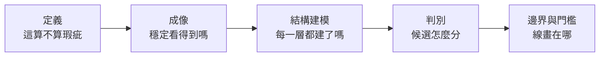
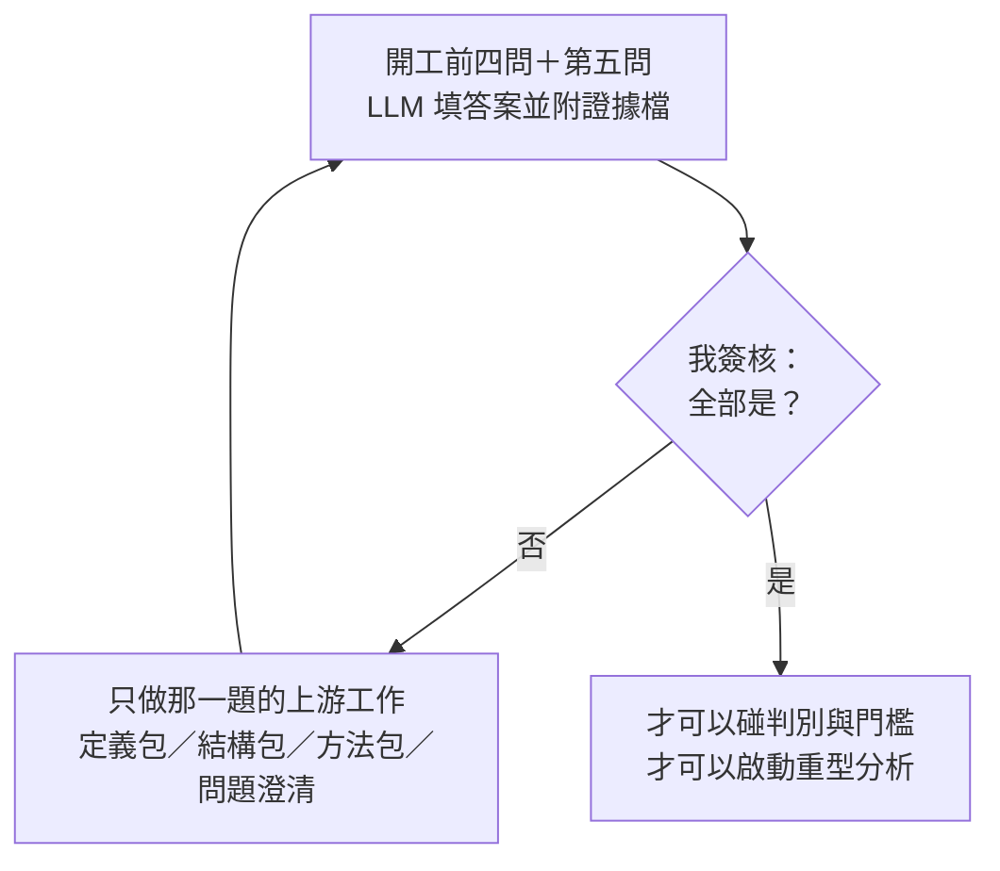
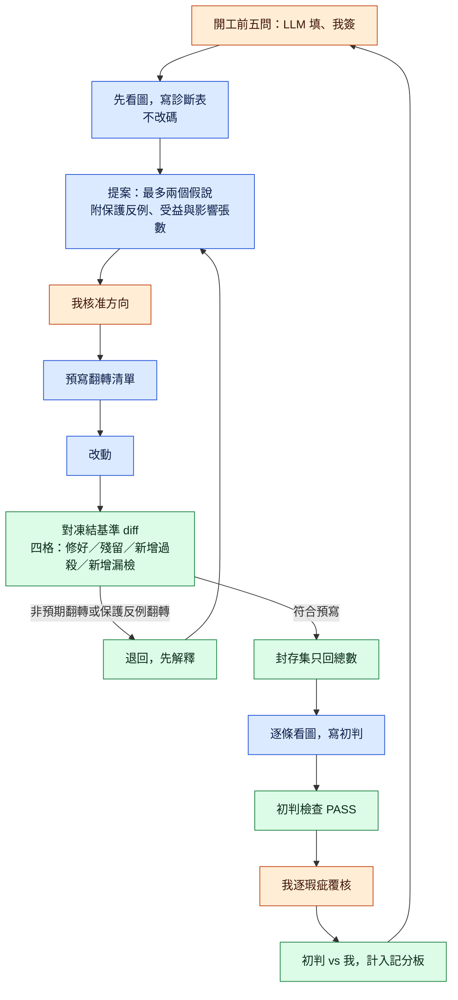
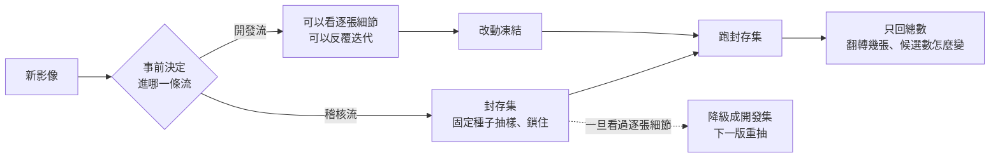
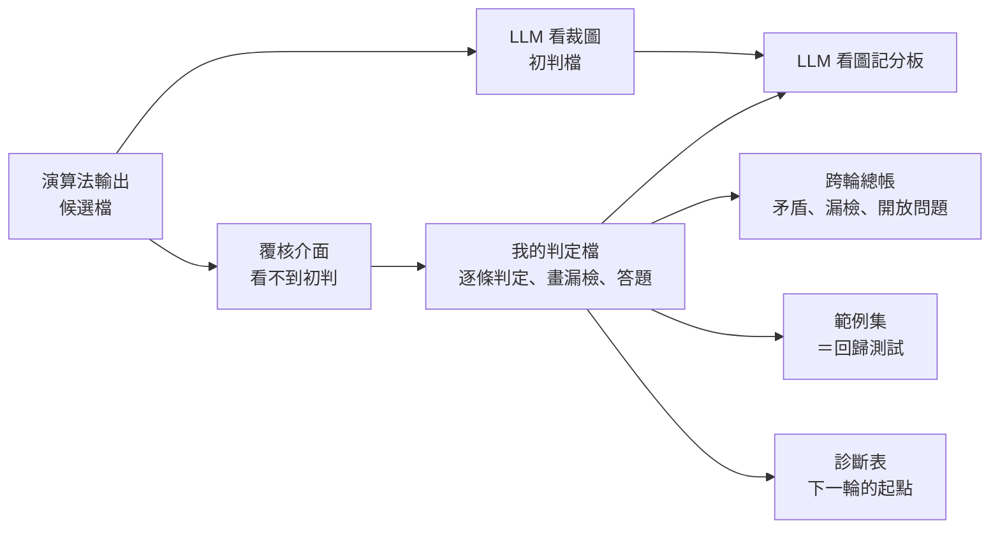
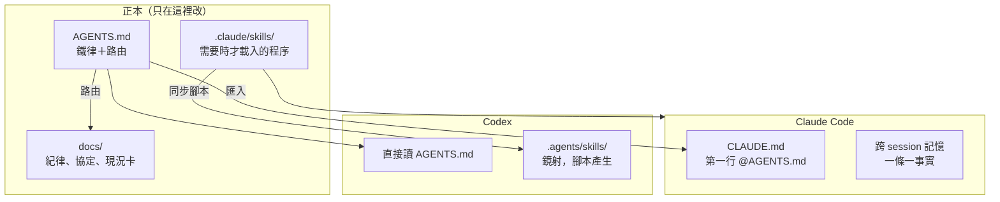
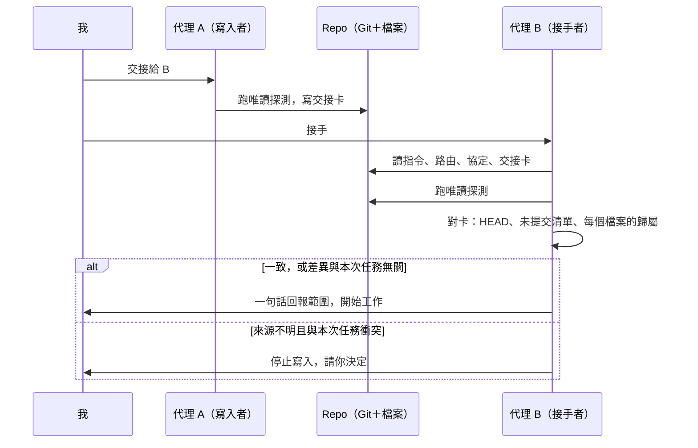
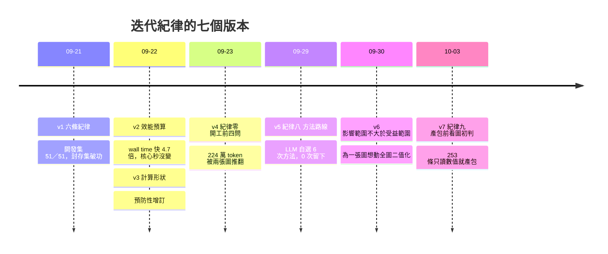

# 示意圖 / Diagrams

> **Summary (EN)**: Hand-drawn Mermaid diagrams only; no customer images or machine screenshots. They cover the convergence order and stage gate, who does what in one iteration round, the development stream versus the sealed holdout stream, the human review data flow, the knowledge architecture shared by two agents, the handoff sequence between agents, and the timeline of how the discipline grew out of failures. GitHub renders them directly.

只放自己畫的示意圖，全部用 Mermaid，GitHub 會直接渲染。不放任何客戶影像或機台截圖。

## 目錄

1. [收斂順序與階段閘門](#1-收斂順序與階段閘門)
2. [一輪迭代：誰負責哪一步](#2-一輪迭代誰負責哪一步)
3. [開發流與稽核流](#3-開發流與稽核流)
4. [覆核資料流](#4-覆核資料流)
5. [知識架構：一個正本，兩個代理](#5-知識架構一個正本兩個代理)
6. [雙代理交接](#6-雙代理交接)
7. [紀律從失敗長出來](#7-紀律從失敗長出來)

---

## 1. 收斂順序與階段閘門

上游還沒收斂時調下游參數，做的功是負的。每輪開工前先過閘門，沒通過只能做上游工作。詳見 [紀律零](../discipline/rules.md#紀律零開工前四問階段閘門)。

## 2. 一輪迭代：誰負責哪一步

藍色是 LLM 做的，綠色是腳本裁定的，橘色是我。完成與否由綠色那幾格裁定，不由 LLM 自述。詳見 [growth/02](../growth/02_from_writing_code_to_converging.md)。

## 3. 開發流與稽核流

封存集事前用固定種子抽樣鎖住，改法期間 LLM 不准看逐張結果；改動凍結後才跑，只回總數。詳見 [紀律五](../discipline/rules.md#紀律五封存集只回總數)。

## 4. 覆核資料流

LLM 的初判和我的判定各自落成檔案，判完才對答案。初判不進覆核介面，避免錨定我的判斷。詳見 [growth/05](../growth/05_human_in_the_loop.md)、[review-pack 範本](../templates/skills/review-pack/SKILL.md)。

## 5. 知識架構：一個正本，兩個代理

每樣東西只有一個正本。Claude Code 用匯入，Codex 讀正本或腳本產生的鏡射；兩邊不共享聊天。詳見 [growth/07](../growth/07_knowledge_architecture.md)、[專案指令範本](../templates/project_instructions.md)。

## 6. 雙代理交接

接手者不相信交接卡，拿 Git 和檔案的實況去核對；來源不明又衝突的修改，交給我決定。詳見 [agent-handoff 範本](../templates/skills/agent-handoff/SKILL.md)。

## 7. 紀律從失敗長出來

兩週內從六條長到十條，除了 v3，每一版都對應一次真實的失敗。詳見 [discipline/](../discipline/)。

---

## 想用在簡報或貼文

GitHub 上的圖是即時渲染的。要圖檔的話，把 mermaid 程式碼區塊裡的內容貼到任何 Mermaid 編輯器，匯出 PNG 或 SVG 即可。
