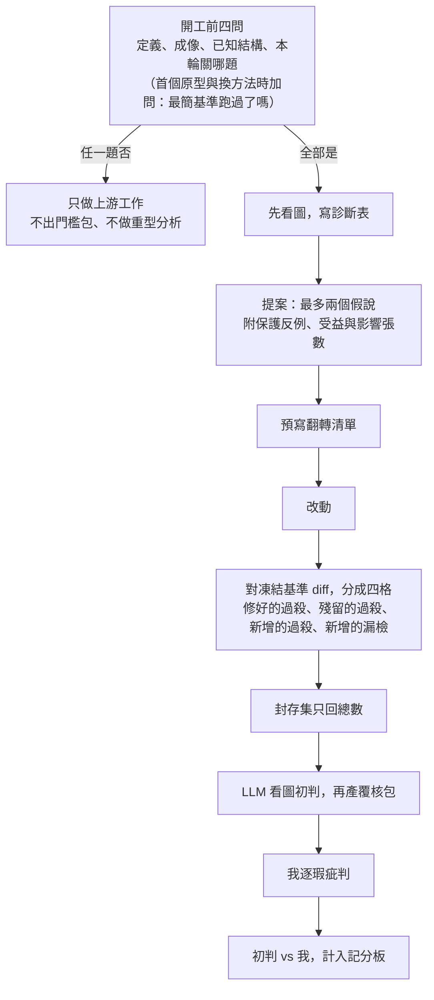

# 02 從「讓 LLM 寫程式」到「讓 LLM 收斂」

> **Summary (EN)**: For the first three months I used the agents as code writers: I stated requirements, they wrote code, and quality came from engineering practice (git baselines, bit-exact regression, 177 tunable parameters, research-vs-machine parity). It was solid engineering, and the constants still all became void when the definition and imaging changed. When iteration on fuzzy-ground-truth inspection started, the review loop's natural objective became "make these review images pass", and the agents optimized exactly that. Between 09-21 and 10-03 the iteration discipline grew from six rules to "rule zero plus nine rules", each added after a concrete failure, and each tied to a human sign-off or a script check. My role shifted from asking for features to defining what "done" means, designing the verification, signing off methods on failure images, and giving per-case verdicts that the agent turns into rules.

---

## 背景

這篇是整個 repo 的主線。[01](01_legacy_takeover.md)、[03](03_method_family_drift.md)～[08](08_handover_engineering.md) 是一個個案例，這篇把它們串起來：我怎麼從「讓 LLM 寫程式」走到「讓 LLM 收斂」。

## 1. 當時怎麼做

2026 年 6 月到 9 月中，我用 LLM 的方式是「讓它寫程式」：

- 我提需求，LLM 寫程式，我看能不能跑、結果好不好看。
- 品質靠工程手段，而且做得很紮實：
  - 第一天就建 git 基準線。
  - 研究版移植到機台程式後，2,700 張影像逐位零迴歸。
  - 177 個影像處理參數做成可調的旋鈕，預設值等於原本的凍結值。
  - Python 研究版和 C# 機台版逐張對拍。
- 結果不好時，我的反應是改提示詞，把要求講得更細。
- 演算法對不對，看覆核圖「有沒有變好」。

## 2. 出了什麼事

### 工程再穩，方向錯了照樣全作廢

第一批四條檢測線，工程上一點問題都沒有。但 9 月中，客戶重新定義了檢測範圍，取像條件也先後換了好幾次，那些常數全部作廢，詳見 [06](06_imaging_domain_and_measurement_trust.md)。留下來的是工具和方法，不是數字。

### 覆核迴圈的天然目標是「讓這些圖過」

真值模糊、要靠人覆核的檢測，迭代的天然目標函數就是「這些覆核圖要過」。LLM 會找最短的路徑去達成它：加一個比例、推一下門檻、針對某一盤特判。每一輪開發集的分數都在上升，泛化能力卻沒有。

第一次撞牆是 09-21：三個比例門檻在 5 張開發圖上調到 51／51 全排除；換到 20 張封存集一跑，真的細絲被刪掉，電極邊反而留下來。

### 規則是從失敗長出來的

從那天起，每一次失敗，都長出一條新規則：

| 日期 | 失敗 | 新增的規則 |
|---|---|---|
| 09-21 | 開發集 51／51，封存集破功 | **v1 六條**：先診斷不改碼；每個改動貼類型標籤；改前預寫翻轉清單、改後對 diff；門檻附分佈和 ±20％ 靈敏度；封存集只回總數；複雜度記帳 |
| 09-22 | 效能重構讓單張時間快了 4.7 倍，就被當成解決了；實測 CPU 核心秒一點都沒少，六台相機同時跑，吞吐量還差好幾倍 | **v2**：效能一律以 CPU 核心秒計帳，不看 wall time |
| 09-23 | 224 萬 token 的分析被兩張圖推翻，詳見 [04](04_two_images_vs_2m_tokens.md) | **v4 紀律零**：開工前四問；先看圖再診斷；每條規則標明靠什麼執行 |
| 09-29 | LLM 一直換路線：自選 6 次方法，0 次留下，詳見 [03](03_method_family_drift.md)。我寫了一份[收斂協作規範](../spec/AOI_LLM_convergence_spec.md) | **v5 紀律八**：方法選擇書、最簡基準實跑、換路線聲明、方法層記分板 |
| 09-30 | 為了接回一張圖上的斷絲，LLM 想動全圖的二值化。我說：「你又犯了一個錯，為了接回一張圖，想去嘗試動二值化這種影響大部份圖片的數值。」 | **v6**：改動的影響範圍不得大於受益範圍 |
| 10-03 | 253 條候選只讀數值就產包，詳見 [05](05_human_in_the_loop.md) | **v7 紀律九**（我立的）：產包前 LLM 先看圖初判，留紀錄對答案 |

v3 是預防性的增訂，沒有對應的失敗案例。

## 3. 學到什麼

1. **要改的不是提示詞，是「什麼算完成」。** 完成與否由檔案裁定：diff、分佈、封存集數字、腳本檢查。不由 LLM 自述。
2. **收斂有順序：定義 → 成像 → 結構 → 判別 → 邊界。** 上游沒收斂時調下游參數，做的功是負的。
3. **每輪要關掉一個開放問題，而不是改善一個數字。** 開發集分數上升很便宜，同一個翻轉可以用五種故事解釋；不確定性下降才是進展。
4. **基準失敗時，LLM 傾向換更強的工具，而不是修失敗的原因。** 方法要在第零天，由人在失敗圖上簽核。
5. **多代理放大的是執行品質，不是方向正確性。**
6. **LLM 的眼睛要用在人前面，並且留下可以對答案的紀錄。**
7. **「不改」是合法的結論。** 「本輪不改」「表示法不足」「這題不能由數據回答」，都可以是一輪的產出。
8. **沒有執行方式的規則，不算規則。** 只靠 LLM 自覺的規則，已經證明無效。每條規則都要對應「我簽核」或「腳本檢查」。

## 4. 現在怎麼做

### 我的角色變了

| 以前 | 現在 |
|---|---|
| 提需求 | 定義「什麼算完成」 |
| 看結果好不好看 | 設計驗證：封存集、預寫翻轉清單、保護反例 |
| 結果不好就改提示詞 | 立規則，並指定靠什麼執行 |
| 回答 LLM 的問題 | 在失敗圖上簽方法；逐瑕疵給判例，讓 LLM 歸納成規則 |
| 相信「已完成」 | 只認檔案證據；沒證據的一律算「未驗證」 |

### 一輪迭代現在長這樣

### 紀律放在哪裡

- 紀律只有一份正本，放在專案裡。指令檔只放一行指標，各個 skill 只連過去，不複製內容。
- 每次改演算法，回覆都要附一個「紀律檢核」區塊，九條各一列。缺任何一列，就不准進覆核包，也不准定版。
- 能用腳本檢查的，就寫成腳本：例如診斷表裡不准出現量名、翻轉集不能只有一條、看圖預算有上限、覆核包 README 的數字要能重算。

## 後來

- v7 之後一直到交機，紀律都沒有再新增。一部分原因是後期的工作重心，轉到了新取像條件下的接入和交機。
- 接入和交機階段沿用的，是同一套思路：先定義什麼算完成，再讓檔案和腳本來裁定。詳見 [06](06_imaging_domain_and_measurement_trust.md)、[08](08_handover_engineering.md)。

## 限制

- 大部分紀律是在同一條檢測線（毛屑）上、大約兩週內長出來的。
- 很多規則的執行方式是「我簽核」，所以最後一道防線，還是我有沒有認真看。
- 這是單一專案的經驗，不是對 LLM 開發的普遍結論。
