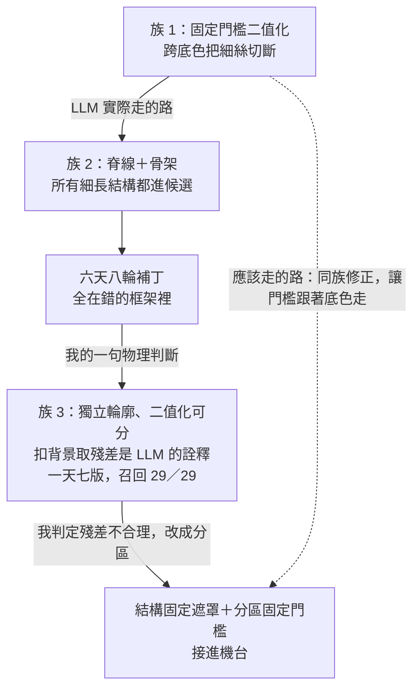

# 03 方法族漂移：LLM 自選 6 次方法，0 次留下

> **Summary (EN)**: When the simplest baseline failed on one image, the LLM agent did not fix the cause. It swapped in a stronger method family, then spent six days and eight rounds patching it. Each patch made local sense and passed my diff-based rules, because those rules never asked whether the framework itself was right. One sentence of physical judgment from me sent it back to a fixed version of the original family, which reached 29/29 recall in a day. The version that finally went into the machine was the simplest family again, with per-zone thresholds I specified after reading the image zones. I now make the agent write a method selection sheet, run the simplest family first, and let me sign "fix within family" or "switch family" on the failure images before any prototype.

---

## 背景

檢測目標是電極試片上的毛屑：細絲、絨毛、團狀異物。難的地方有兩個：

- **底色不一致**：同一張圖裡有黑色電極、灰色帶、白色底。
- **產品本身就有很多細長結構**：電極邊、隔片的框、藥膜刷痕，看起來都跟細絲很像。

分工是：LLM 寫演算法、產出覆核包；我不寫演算法，只看圖覆核。

## 1. 當時怎麼做

- 第一版是最簡單的方法：**固定灰階門檻二值化，再找輪廓**。
- 它在一張圖上失敗了：一條亮絲跨過黑底和灰帶，被切成好幾段，黑底那段整個漏掉。
- LLM 沒有修這個失敗，而是**整個換成更強的方法**：方向性局部對比找脊線、骨架化、取最長路徑。當輪紀錄寫的理由是「固定門檻在不同底色下會切斷細絲」。
- 我只能覆核結果，判斷不了「換方法」這一步對不對，就讓它繼續做下去。

## 2. 出了什麼事

新方法會把**所有**細長的對比結構都抓進候選，包括電極邊、隔片框和藥膜刷痕。接下來六天八輪，LLM 都在想辦法「把像絲的結構濾掉」。

下表是那兩週的記分，最後一列是之後的結局。日期是 2026 年，「下場」是事後回頭看的結果：

| 日期 | 方法或規則 | 誰提的 | 下場 |
|---|---|---|---|
| 09-18～20 | 族 1：固定門檻二值化＋輪廓 | LLM（最簡基準） | 跨底色切段 → 被換掉，沒有修 |
| 09-21 | 族 2：脊線＋骨架＋最長路徑 | LLM | 抓進所有細長結構，之後六天都在補丁 |
| 09-21 | 三個比例門檻 | LLM | 開發集 5 張圖 51／51 全排除，封存集 20 張一跑就破功：真絲被刪、電極邊留下 |
| 09-21 | 拓樸支線表示法 | LLM | 沒有定版 |
| 09-22 | 灰區分隔面（大型多代理分析） | LLM | 被兩張放大圖推翻 |
| 09-24 | 路徑與凸包邊平行 | LLM | 前提不成立，結論是「表示法不足，不改程式」 |
| 09-24～26 | 把隔片當成已知結構 | **我**（「亮帶就是隔片的邊」） | 成立 |
| 09-27 | 縮小取樣距離 | LLM | 被我否決：在錯的框架裡打補丁 |
| 09-27 | 族 3：已知結構建模→扣背景→殘差二值化→獨立輪廓 | **我**給方向；「扣背景取殘差」是 LLM 的詮釋 | 一天七版，召回 29／29 |
| 10-05～06 | 結構固定遮罩＋分區固定門檻，不再逐像素扣背景 | **我** | 成立，接進機台 |

從 09-21 到 09-27，**LLM 自己提的方法或規則有 6 次，沒有一次留下來；留下來的 2 次，都來自我一句物理判斷。** 最後接進機台的版本，也是我定的。

族 3 的起點是我在 09-27 說的一句話：「細絲是獨立輪廓，二值化可分，區分電極邊緣有很多方法。」其中「先扣背景、再取殘差」是 LLM 對這句話的詮釋，不是我說的。

還有兩個事後才看清的事實：

- **更強的方法也更貴**。族 2 單張約 2.45 CPU 核心秒，是當時效能預算的 4 倍；族 3 的分割段只要 0.32 核心秒。
- **正確答案一直在手邊**。族 1 失敗的原因是「底色不一致，一個門檻管不了全圖」，該做的是同族修正：讓門檻跟著底色走。最後接進機台的「分區固定門檻」就是這個修正，09-21 當天只差一步。

## 3. 學到什麼

1. **我當時的規則只管「框架內怎麼改」，沒有一條問「框架對不對」。** 預寫翻轉清單、門檻附分佈、封存集只回總數，這些我都要求了，LLM 也照做了。但它們檢查的都是 diff，不是框架。
2. **基準失敗時，LLM 傾向拿手邊更強的工具換掉整個方法，而不是修失敗的原因。** 換了之後，每一步補丁在局部都講得通，所以單看每一步都挑不出錯。
3. **方法是「漂」進去的，不是比較之後選出來的。** LLM 從來沒有用證據否決過「建模背景再二值化」這條路，只是沒去試。我那時的抱怨是：「毛屑調這麼久，連二值化都沒用，我提了就直接採用。」換句話說，它既沒有認真比較過自己的方案，也沒有認真檢驗過我的提議。
4. **我不寫演算法，但我能在失敗圖上判斷「該修還是該換」。** 這個判斷原本到第十輪才出現，其實可以提前到第零天。

## 4. 現在怎麼做

- **方法選擇書**：每條檢測線在第一個原型之前，先列出至少三個方法族，由簡到繁。每一族寫三件事：
  - 它假設影像長什麼樣
  - 會在哪裡失敗
  - 計算量多大

  最簡單的那族一定要實際跑過，失敗的圖拿給我看。
- **由我簽核**：我在失敗圖上簽「修同族」或「換族」，LLM 不可以代答。預設是先修同族。
- **換族聲明**：真的要換方法，必須寫清楚三件事：同族最小修正是什麼、為什麼它不可能成立、證據在哪。三項寫不齊就不准換，有腳本會檢查。
- **方法層記分板**：欄位是「日期｜方法｜誰提的｜理由｜下場」，只增不改。它不會讓 LLM 變聰明，但能讓我在第三輪就看出「LLM 提的框架又要死了」，而不是等到第十輪。
- **每輪例行一句**：本輪這種失敗，最簡單的處理方法是什麼？用了沒有？沒用的理由是什麼？這一句很便宜，而且給了我一個可以反問的具體主張。

這些規則我先寫成一份跟專案無關的[收斂協作規範](../spec/AOI_LLM_convergence_spec.md)，再交給 LLM 併入專案的迭代紀律。

## 後來

10-05，我看完殘差造成的過殺之後判定「用殘差並不合理」：逐像素扣背景時，參考點是模型不是周圍，模型錯的地方全變成輪廓，十幾個補丁都是這樣來的。我改成依影像的分區特徵來做：已知結構寫成固定樣板，每一區各自用固定門檻。最後接進機台的就是這一版。也就是說，最後用的還是最簡單的那一族，只是加上了我給的分區。詳見 [09](09_labels_are_not_convergence.md)。

（2026-11 更正：本篇初版把族 3 整個寫成我提的。實際上方向是我給的，「扣背景取殘差」是 LLM 的詮釋，後來被我推翻。）

## 限制

- 這是**單一檢測線、大約兩週**的記分，不是對 LLM 方法選擇能力的普遍統計。
- 召回 29／29 是開發集內、經過人工覆核的數字，不是量產驗收。
