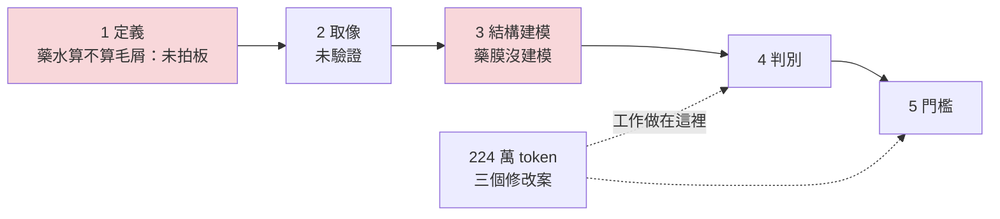

# 04 224 萬 token 被兩張圖推翻

> **Summary (EN)**: To remove one false-positive candidate without losing any real fiber, the LLM agent ran a five-facet multi-agent analysis over the numeric features of 274 candidates. It took about 2.24 million tokens and three hours, and produced three rule proposals. It followed every rule I had in place, and never opened an image. Two zoomed crops (1,746 tokens) overturned all of it: reagent is yellow, broken blobs; fibers are continuous threads of constant width. The real problems were upstream: the defect definition had not been signed off, and the reagent film was not modeled. I now run a stage gate before every round, so no threshold work or heavy analysis starts until definition, imaging and structure are settled, and every rule states how it is enforced.

---

## 背景

接續 [03](03_method_family_drift.md)。當時毛屑檢測用的是「路線 2」：先抓出一大批細長的候選，再用三個比例門檻篩掉不像毛屑的。

其中有 11 條候選，其實是正常點上去的藥水，不是毛屑。10 條被門檻篩掉了，剩 1 條漏網。我在覆核介面把它判成過殺，備註寫：「本來就不是毛屑，而且是正常點藥，完全不該抓到這種『輪廓』。」

LLM 的任務是：找一條規則把這條踢掉，同時不能誤刪任何一條真毛屑。

## 1. 當時怎麼做

- LLM 第一次診斷的結論是「只有一例，依規則不能改」。所以它出了一個覆核包，請我把門檻附近的候選逐條判一次，補足例數。
- 我判完，把 11 條標成同一類「正常點藥」。例數夠了，依當時的規則，可以提修改案了。
- 回讀我的覆核結果時，LLM 啟動了多代理分析：五個面向同時進行，在 274 條候選的數值特徵裡，找一個能把那一條分出去的分界。這次分析用了約 224 萬 token、三個小時，產出三個修改案，都是想在現有的判定上再加一個條件。
- 當時的七條紀律它全部照做，每輪附的檢核區塊一列都沒缺。但整輪下來，它沒有打開任何一張影像。

## 2. 出了什麼事

我先指出一件事：這 11 條是同一類東西，其他 10 條本來就被擋掉了，只有這一條碰巧三關都過。專門為它加一條規則，切到的是雜訊，不是類別。

數字也是這樣說的：同一類候選在主要特徵上的內部差異，是判定能用的範圍的 10 倍。也就是說，這個量根本分不開這一類。

接著 LLM 去看了兩張放大裁圖，只花了 1,746 token，整輪分析就被推翻了：

- **藥水**：黃色、斷續、一團一團，有面積，邊界模糊。
- **毛屑**：粗細一致的連續絲，邊界清楚。

一眼就能分開。

| 做法 | 花費 | 結果 |
|---|---|---|
| 多代理數值分析（五個面向） | 約 224 萬 token、三小時 | 三個修改案，後來全部撤回 |
| 看兩張放大裁圖 | 1,746 token | 藥水和毛屑一眼可分 |
| 把整包 68 張圖全部看完 | 不到 10 萬 token（約數值分析的 4％） | — |

事後回頭看，問題不在判定這一步，而在更上游：

- **錯在「產生」，不在「判定」**：一團一團的藥水，被骨架化串成了一條線，才變成候選。這條候選根本不該存在，在判定階段多加條件，只是貼補丁。
- **藥膜區沒有建模**：系統的結構模型裡沒有藥膜這一層。候選落在系統不認識的區域，反而被解讀成「沒有沿著任何已知結構走，所以更像異物」。方向剛好反了。
- **「藥水算不算毛屑」是定義問題**：答案在我這裡，不在數據裡。而當時這個定義我還沒有拍板。

問題出在第 1、3 關，工作卻做在第 4、5 關。

## 3. 學到什麼

1. **規則全都守了，還是走錯。** 當時的規則都在管「怎麼改」，沒有一條問「現在該不該改」。檢核區塊填得再完整，也擋不住在錯的階段用功。
2. **數據是 LLM 唯一能自己驗證的東西。** 所以它會不自覺地把問題縮成「手上數據答得了的題目」。定義問題不在數據裡，它應該把問題交還給我，而不是用數據去逼近答案。
3. **多代理放大的是執行品質，不是方向。** 五個代理讀同一份規則、跳過同一個階段，結果就是錯五倍。
4. **看圖不貴，貴的是用來代替看圖的分析。**
5. **沒有執行方式的規則，不算規則。** 只靠 LLM 自覺遵守的規則，這次證明無效。每條規則都要寫明靠什麼執行：由我簽核，或由腳本檢查。

## 4. 現在怎麼做

這次失敗後，LLM 依這個案例起草了新規則，我逐條拍板，隔天就寫進專案的迭代紀律：

- **開工前四問（階段閘門）**：每一輪動工前，先回答四題：
  1. 瑕疵的定義拍板了嗎？
  2. 這個瑕疵在目前的取像條件下，穩定看得到嗎？
  3. 產品的每一層都建模了嗎？哪些還沒有？
  4. 這一輪要關掉哪一個開放問題？

  LLM 寫答案，並指向證據檔案，由我簽核。任何一題答「否」，就不准出門檻相關的覆核包，也不准啟動多代理、全量統計這類重型分析，只能做那一題的上游工作。
- **先看圖，再寫診斷**：診斷表有一欄「我看到什麼」，要用白話寫顏色、形狀、連不連續、和周圍的關係，不准出現任何演算法的量名。腳本會檢查，這欄空白或出現量名，整張表退回。
- **先問候選是哪一步產生的**：如果是「根本不該存在」的候選，只能回頭改定義或表示法，不准在判定階段加條件補救。
- **同類差異比判定範圍還大，就禁止調這個量**：先量同一類內部的差異；如果比判定能用的範圍還大，這個量就沒有分辨力。
- **每輪關掉一個開放問題，而不是改善一個數字**：同一題掛了兩輪沒答，就停止出新的覆核包，改出問題澄清包。
- **每條規則標明執行方式**：整理成一張表，每條都對應「我簽核」或「腳本檢查」。

隔天，用同一份覆核資料、同一個 LLM，照新流程重做一次：看了 23 張圖（約 2.1 萬 token），四問有 3 題答「否」，所以沒有出判別包。這次的產出是 0 個修改案、2 項上游工作、3 題要問我的開放問題。資料沒變，變的只有流程。

## 後來

- 09-24 我拍板了定義：只排除正常點藥。
- 之後把隔片當成已知結構建模，再換到「建模背景→殘差二值化」的方法，見 [03](03_method_family_drift.md)。
- 09-29 階段閘門又加了第五問：「最簡單的方法跑過了嗎？」這是 03 的教訓。

## 限制

- 這是單一事件。224 萬、1,746、4％ 都是這一輪的實際數字，不是一般的比例。
- 階段閘門靠人簽核，最後一道防線還是我有沒有認真看。
- 文中數字都是開發期的內部覆核結果，不是量產驗收。
