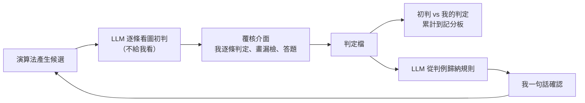

# 05 人在迴路：讓我的判斷留得下來、對得上答案

> **Summary (EN)**: In this project there was no ground truth except my judgment on images. Early on, that judgment lived in chat: the agent showed overlay images, I described what was wrong, and the agent copied it into JSON by hand. Questions referred to things I could not find, abstract rule questions went unanswered, review packs were padded with cases the agent could have filtered itself, and one pack was built from numbers alone. I set up a per-defect review tool with a fixed contract, moved every question onto the images, had the agent turn my per-case verdicts into rules for a one-line sign-off, and required it to look at every candidate and record its own verdict before I see the pack. My verdicts are then scored against its verdicts, so I can tell when its eyes can be trusted.

---

## 背景

這個專案沒有標準答案。什麼算瑕疵、哪一條是過殺，最後都由我看圖決定。我不寫演算法，所以我在迴路裡的工作只有一件：**看圖判斷**。

這篇要回答兩個問題：

- 我的判斷要怎麼留下來，讓下一輪、下一個 session 都用得到？
- 我怎麼知道 LLM 看圖看得對不對？

## 1. 當時怎麼做

- **判斷留在對話裡**：LLM 出一張疊了紅框的圖，我在對話裡口述哪個框是過殺、哪裡漏了，LLM 再手抄成檔案。
- **問題也在對話裡問**：例如「G1 那 8 處是不是真絲？」
- **問抽象的規則題**：例如「面積下限設成某個值可以嗎？」
- **覆核包照數值產生**：演算法跑出多少候選，就整批丟進包裡給我判。LLM 產包前不看圖。

## 2. 出了什麼事

| 發生的事 | 根本原因 |
|---|---|
| 口述會漏、會抄錯；換一個 session，前面判過什麼就說不清楚 | 判斷沒有落成帶座標的檔案 |
| 「G1 那 8 處」是哪 8 處？我得自己去翻圖 | 問題沒有錨定到圖上 |
| 規則題我幾乎不答。我那時說：「我雖然沒回答問題，但我針對每個瑕疵去檢查過殺漏檢。」 | 我的知識是逐條的判例，不是規則 |
| 一包 661 條候選被我退回：「你過殺了一堆 OK 輪廓，根本不需要在 UI 覆核。」 | LLM 把自己看得出來的過殺也丟給我 |
| 用放大裁圖問「這個算不算」，我幾乎全答「要抓」；結果原本判沒有毛屑的 12 張裡，有 8 張變成 NG | 放大圖讓每個小東西都像瑕疵，我看不出它有多普遍 |
| 一包 253 條只讀數值就產出，我看完說：「演算法感覺被改爛了。」 | LLM 產包前沒看圖 |
| 我在介面上早就答了題，LLM 卻連續兩天說「還在等第 2 題」 | 它只看有沒有定稿檔，沒有讀答案檔 |

253 條那一包，LLM 事後抽 30 條看圖：9 條是真瑕疵、18 條是產品結構的殘影、3 條不確定；被新版拿掉的 14 條裡，還有 3 條看起來是真的。這些在產包前看 11 張裁圖表（約 6 萬 token）就能知道。

## 3. 學到什麼

1. **我的時間是最稀缺的資源。** 覆核是用來判 LLM 拿不準的東西，不是替它做它自己看得出來的事。
2. **我給的是判例，不是規則。** 從判例歸納出規則，是 LLM 的工作；我只需要確認一句「對」或「不對」。
3. **沒有落成檔案的判斷，等於沒判。** 判斷要有座標、有原因、可以跨輪比對，才會累積成專案的資產。
4. **問題本身會影響答案。** 先告訴我「這類東西有多普遍」，再問我要不要抓。
5. **我當時說：「我不知道 LLM 對不對，只會覆核。」** 解法不是讓 LLM 更有自信，而是讓它在我之前先下判斷、留下紀錄，等我判完再對答案。

## 4. 現在怎麼做

### 逐瑕疵覆核介面

由我拍板五項設計，LLM 實作：

- 本機跑的小服務，用瀏覽器開。
- 一輪最多 500 張圖。
- 漏檢用多邊形畫。
- 每張圖要有整張判定。
- 第一版不做多版本並排。

每個候選都帶原圖座標。我逐條判「認同／過殺／輪廓不準」；不是認同的，就從固定詞彙裡選原因。每張圖的每一類瑕疵，各自判「有／無／不確定」。

有兩條規矩：

- **沒有勾「已覆核」的圖，不能當成我認同。**
- **每個覆核包都要附候選檔和一鍵開啟的捷徑**，缺了就不算覆核包。

同一張圖跨輪的判定會自動對照，矛盾的列出來給我看。要撤銷前一輪的判斷，就在新的一輪記一筆，不改舊檔。

### 問題掛在圖上，不在對話裡問

我的要求是：「把問題完整生成到 reviewui 上，包括圖片、想問的問題、回答的格式，我直接在 UI 上回答。」

所以現在每一題都要錨定到圖上的某個候選或某塊區域，附上裁圖，寫明回答格式（單選、多選、逐處回答）。錨不到圖的問題不准掛。我按下去，答案就即時寫進檔案；LLM 引用待答題之前，要先讀答案檔，而不是看有沒有定稿。

### 判例 → 規則 → 一句確認

不再問我抽象的規則題，改成從我的判定反推。

例如有 7 條藍紫色候選：我把小的 4 條判成過殺，大的 3 條沒動。LLM 從這個分佈推出一條「最小面積」規則，下限取在兩群之間，再問我一句「是不是這個意思」。我回「核准」，它才實作。

LLM 推不出來的就照實說推不出來，不硬湊規則。同一批裡有一條邊緣殘影的規則，就是因為量出來和真瑕疵交錯，結論是「不加規則」。

### 覆核包只放需要我判的

- LLM 先自己看完全部候選。看得出是結構殘影的，回去修正已知結構的標示，不進包。
- 被濾掉的候選不列出來。
- 每包的數量要低到我願意逐條判完。

出定義題之前，LLM 要先數這類東西在整批出現幾張，寫進題目，例如「這類在 29 張裡 20 張都有」，並附一排由大到小的實例，讓我指出分界在哪。

### 產包前先看圖初判

這條是我立的：「出覆核包之前 LLM 要先『看過』圖並且有一個初步判斷，而不是看數據而已。」

- 每一條候選，LLM 都要先看裁圖，寫下初判（真瑕疵／結構殘影／不確定），理由用白話寫，不准出現演算法的量名。一千條以內全看，不抽樣。
- **初判不進覆核介面**，我判的時候看不到，避免被它帶著走。
- LLM 不准自己把候選從包裡拿掉，那等於把過殺藏起來。
- 我判完之後，腳本算出「初判 vs 我」的對照，累計到記分板。命中率低，要修的是 LLM 看圖的方法，不是演算法。

目前記分板上有兩輪：

| 輪次 | LLM 初判 | 我的判定 |
|---|---|---|
| 溢藥定義包（10-22） | 真瑕疵 34、不確定 1 | 34 條全部認同；不確定那 1 條也認同 |
| 毛屑貼邊報告（10-24，70 張裁圖） | 真瑕疵 22、結構殘影 28、不確定 20 | 22／22 認同、28／28 判過殺；不確定的 20 條我全判真 |

第二輪的「不確定」很有用：20 條全是灰色的髒污帶和糊斑，我全判成真瑕疵。這等於告訴我 LLM 在哪一類東西上看不準，下次這一類要多看一眼。

## 後來

從 09-21 到 10-22，總共出了 36 個帶候選檔的覆核包，其中 20 個留下了我的判定檔。之後的規則修改、門檻設定、定義拍板，都能追到某一包裡我判過的某幾條。

## 回頭看（2026-11）

做完整個專案再看，這套覆核基礎設施在我的開發體感上，**並沒有替我收斂太多**。

它做得好的是這幾件事：

- **留下判斷。** 每個判定都有座標、原因，可以跨輪比對。
- **當回歸測試。** 我指認過的候選累積成範例集，新版本不准翻轉它們。
- **量 LLM 的眼睛。** 初判和我的判定對答案，知道它在哪一類東西上看不準。
- **抓到 LLM 偷懶。** 253 條沒看圖就產包，是在覆核時被我發現的。

但方向不是從這裡來的。LLM 從我的判定推出來的規則（例如上面那條最小面積），不到一週就被我直接訂的一條簡單規則取代。真正讓細絲檢測收斂的，是我看影像的分區特徵之後給的指示：哪一區是什麼底色、哪條亮線是結構、異物比背景亮還是暗。

所以覆核介面的定位是**驗證工具，不是導航**。詳見 [09](09_labels_are_not_convergence.md)。

## 限制

- 記分板只有兩輪，樣本很小。它是「量 LLM 判圖可不可信」的機制，不是「LLM 判圖準確率 100％」的證據。
- 真值就是我的判斷，我自己也可能前後不一致。跨輪對照會把矛盾列出來，但最後怎麼算，還是由我決定。
- 覆核介面和檢查腳本都是 LLM 寫的；我負責的是設計決定和規則。
