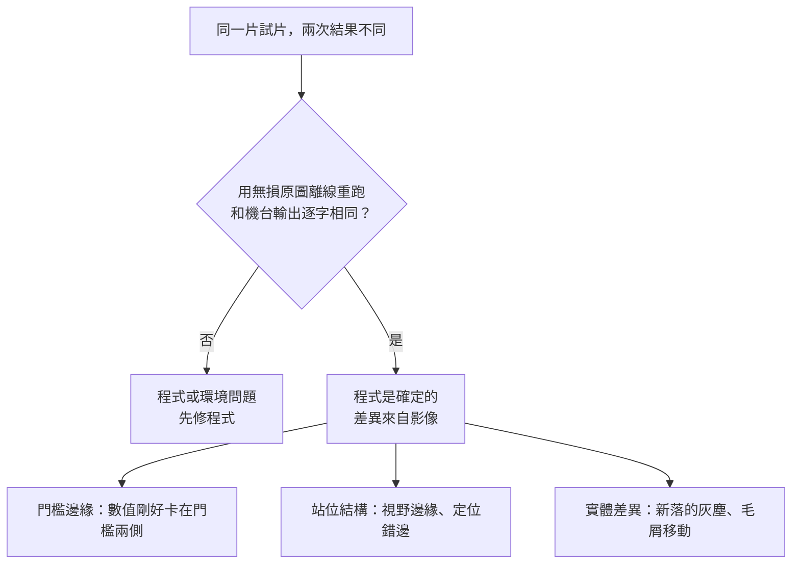

# 06 取像條件與量測可信度：常數屬於取像條件，不屬於演算法

> **Summary (EN)**: Early on I treated imaging as fixed: algorithms were tuned on a stored image set and proven with bit-exact regression. Then the imaging changed at least three times (cameras that did not match the validation set, a lighting change that voided every image before it, a final camera setup), and each time the frozen constants, statistics and regression baselines became meaningless. On the machine, the same plate scanned twice gave different results, lamp warm-up drift was as large as the threshold margin, and the pixel scale in reports had never been measured. I now bind every constant to its imaging domain, prove program determinism with lossless re-runs before discussing any difference, split differences into threshold-edge, station-geometry and physical-change cases, separate "convertible" thresholds from "definition" questions when the domain changes, and treat stable imaging as a gate before any threshold work.

---

## 背景

AOI 的判定，是「影像」加上「門檻」。前面幾篇談的都是演算法怎麼收斂；這篇談的是另一半：**影像本身可不可信，量出來的數字能不能重現。**

## 1. 當時怎麼做

- 把取像條件當成固定不變的。演算法用手上一批存好的影像研究、調門檻。
- 研究版移植到機台程式之後，用 2,700 張影像做**逐位零迴歸**：新舊版本每一張的判定、每一個量測值都要完全相同。
- 上機後遇到結果對不上，第一個反應是去調門檻。

## 2. 出了什麼事

### 取像條件至少換了三次，每次整批作廢

| 時間 | 發生什麼 | 作廢了什麼 |
|---|---|---|
| 09 月初 | 上機才發現，機台相機拍出來的影像和手上的驗證圖連長寬比都不同，相機很可能早就換過。我拍板：「一切以現在相機實拍為主。」 | 第一批檢測線的凍結常數、2,700 張零迴歸基準 |
| 10 月初 | 我重新調整了光源：「1004 以前的影像都是作廢的。」 | 9 月所有實拍批次、正式資料集，以及在上面做的統計和覆核結論 |
| 10 月下旬 | 相機設定定版（白平衡、曝光） | 藥線的門檻要重新換算 |

逐位零迴歸在這裡完全失效。它能證明「程式改了之後行為沒變」，卻不能證明「這個行為在新的影像上是對的」。

### 同一片試片，掃兩次結果不同

同一片試片放到左右兩個站各掃一次，300 格裡有十幾格判定不同。這時候最容易犯的錯，是馬上去調門檻。

### 燈還沒熱，門檻就被吃掉

- 原本的程式按「開始檢測」才開燈。開工第一盤，白底比正常暗約 10％，幾分鐘內才慢慢爬升。
- 同一盤連拍 7 分鐘，點藥的飽和度一路往下掉，掉的幅度剛好等於門檻的餘裕。燈不穩，任何門檻都會整盤翻。
- 有一次，「隔片在不在」用的是固定灰階門檻。燈暗的那一盤，51 格被誤判成隔片不見。

### 比例尺從來沒有實測過

我問 LLM「檢測精度多少」，才發現報告裡用來把像素換成 mm 的比例尺，是從舊資料沿用下來的，從沒量過。我用尺量了試片的幾個尺寸給它，換算出來，舊比例尺會讓所有 mm 數字少算約 30％。

### 用被檢物自己當參考，會把瑕疵也正規化掉

我問過：「每張先量白底亮度，再動態調參數，能不能收斂到工業級？」LLM 拿同一片、燈暗和燈亮兩次的影像實測：

- 燈的漂移大致是整體變亮或變暗，用白底校正確實能把燈暗造成的誤判全部消掉。
- 但真的隔片偏掉、不見的格子，因為白底也是在那一格裡量的，同樣被「校正」成正常，判成 OK。

## 3. 學到什麼

1. **常數屬於取像條件，不屬於演算法。** 門檻是在某一組相機、光源、曝光下量出來的；條件一換，數字就只剩歷史意義。
2. **零迴歸證明的是「沒變」，不是「對」。** 它是重構時的保險，不是驗收。
3. **先分清楚差異從哪裡來，再談門檻。** 同一片掃兩次不同，可能是程式、成像、站位，也可能試片本身真的變了。沒分清楚就調門檻，等於在追雜訊。
4. **換取像條件時，有些門檻可以換算，有些不行。** 不能換算的通常是定義問題，要回到我這裡拍板。
5. **成像穩定是門檻的前提。** 燈不穩的時候調門檻，做的功是負的。這就是 [04](04_two_images_vs_2m_tokens.md) 開工前四問的第二題。
6. **錯的量測比沒有量測更危險。** 定位器該回「找不到」的時候卻回了一個離譜的數字，下游會照單全收。
7. **「訊號就是亮度」的檢查，不能用被檢物自己當亮度參考。** 否則瑕疵會跟著一起被校正掉。

## 4. 現在怎麼做

### 域紀律

- 每個凍結常數都標明它屬於哪一個取像條件（我們叫「域」）。研究工具解碼影像的方式和機台程式不同，兩邊重校出來的常數也不混用。
- 引用舊域的數字，一律標「作廢」。
- 舊域作廢時，連帶列出受影響的東西：常數、基準、統計、覆核結論。

### 先證明程式是確定的

- 用無損格式存的原圖離線重跑，和機台輸出 600／600 逐字相同，才算證明「程式不是變因」。
- 存成 JPG 的原圖重跑，有 1.7％ 的格子判定翻轉，全在門檻邊緣。所以要拿存檔對機台數字時，一律存無損格式。後來把存圖格式做成組態選項，由現場選。
- 再把差異分成三類，每一類附左右對照的裁圖。例如有一次 16 個差異：門檻邊緣 8、站位結構 4、實體差異 4。
- 只有「站位結構」那類是程式該修的；「門檻邊緣」要回到門檻和重複性的關係；「實體差異」本來就該不同。

### 換域時分「可換算」和「定義題」

- 同一片試片在新舊兩個域各拍一次，逐格配對。
- 點藥填充的顏色門檻，可以從兩域的分佈換算過去；換算後同一片逐格 0 翻轉，才採用。
- 溢藥試遍了整個門檻範圍，沒有一組能逐格重現舊域的結果。所以結論不是「找不到好門檻」，而是「新域看得到以前看不到的淡黃邊，它算不算溢藥，是定義問題」。LLM 出了一個定義包，由我看圖拍板。

### 成像穩定先於門檻

- 燈的暖機漂移量出來之後，「成像穩定」就不再是假設，而是要檢查的項目。交機後，燈的開關也改成和開始／結束檢測脫鉤，結束檢測不再關燈；這項修改還在等上機驗證。
- 白底動態校正只當成「有範圍的細修正」：以本域的校正值為基準，超出範圍就告警。它不能取代穩定的光源。

### 門檻要比重複性寬

- 先量同一格重拍的變動範圍：偏移量、填充率、判定翻轉格數。門檻的餘裕要大於這個範圍。
- 定位器找不到東西時回「無法判讀」，判 NG，而不是回一個數字讓下游照用。

## 後來

交機時，這些變成了現場工具和文件：

- 光場檢查頁：開燈後看各台相機的亮度是否回到基準。
- 存圖格式可選。
- 同片重掃的對照報告格式。
- 定版文檔裡的「已知限制」，例如視野上下緣是兩站共同的盲區。

## 限制

- 比例尺是用尺量試片換算的，誤差約在百分之幾；要更準，需要校正片或設計圖。
- 重複性是在少數幾盤上量的，不是長期統計。
- 燈的穩定時間只知道落在一個範圍內，沒有精確量出來。
