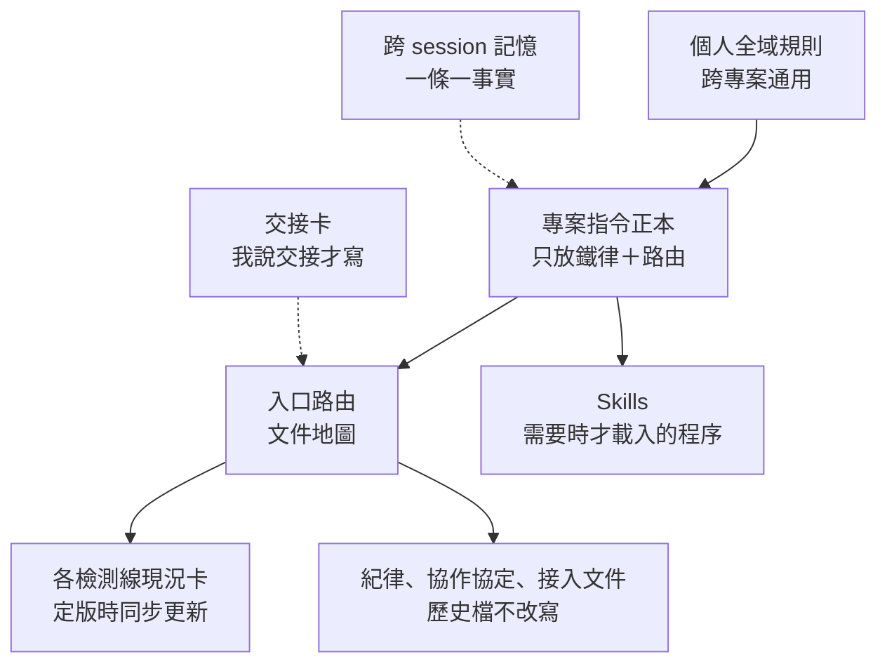

# 07 LLM 專案的知識架構：單一正本、可載入的程序、跨 session 記憶、明確的授權語義

> **Summary (EN)**: An LLM agent starts every session with no memory, and in this project two different agents (Claude Code and Codex) took turns on the same repo. Early on, one instruction file held everything, including volatile status, and it went stale; context was re-explained in chat; one agent's tool auto-generated a second set of rules from another project; "integrated" and "deployed" were confused; and "may I?" was asked for every change. I ended up with a layered structure: one project instruction file holding only hard rules and routes, status cards that are updated at sign-off, loadable skills for procedures, a cross-session memory of one fact per entry with why and how to apply, a protocol where agents share files and verification output but never chat, and explicit authorization phrases that map to specific scopes.

---

## 背景

LLM 每個 session 開始時都是失憶的。這個專案又有兩個不同的代理輪流工作：Claude Code 和 Codex，兩邊的聊天紀錄互不相通。

五個月下來，專案累積了檢測規則、我的拍板、現場事實、踩過的坑。問題是：**這些東西要放在哪裡，才能讓下一個 session、另一個代理，在對的時機讀到對的那一份？**

## 1. 當時怎麼做

- **一份指令檔什麼都寫**：規則、各檢測線現況、目前的 commit、測試清單，全寫在同一個檔案裡。
- **每個 session 靠對話重新交代**：上次做到哪、哪些已經拍板，由我在對話裡再講一次。
- **兩個代理各有各的設定**：Claude Code 讀自己的指令檔和 skill 目錄，Codex 讀另一套。
- **授權靠每次問**：LLM 每改一個檔案就問「可以嗎」。

## 2. 出了什麼事

| 發生的事 | 根本原因 |
|---|---|
| 指令檔裡的「現況」和「目前 commit」很快就過時，但每個 session 一開始都會先讀到它 | 會變的現況，寫在不常更新的地方 |
| 舊的取像條件早就作廢了，指令檔裡卻還寫著「驗證主資料集是某某批」，一個多月後才改掉 | 同上；而且沒有規定「定版時要同步改哪些檔」 |
| Codex 桌面版匯入 Claude Code 的對話紀錄時，在子目錄裡自動產生了一份指令檔和一批 skill，內容是別的專案的舊規則 | 規則有兩個以上的來源，而且沒有說哪個是正本 |
| LLM 指出現況卡寫「已接入檢測模式」，但現場配方根本沒改，以為文件寫錯了；我反問「這有問題嗎」，查證後才發現文件沒錯 | 「程式掛進去」和「現場在跑」是兩件事，卻常被混著講 |
| 每寫一份文件、加一段程式，都要先問「可以嗎」，拖慢節奏 | 授權沒有分層，所有同意都長一樣 |
| 交機前，LLM 一次列出 58 項待辦給我拍板，我根本沒細看 | 一次給太多，我的「同意」就只是名義上的 |
| 換到公司電腦之後，我第一句話就是問「你還有這個專案的開發記憶嗎？」 | 記憶如果只存在對話裡，換機器就沒了 |

## 3. 學到什麼

1. **指令檔只放鐵律和路由，不放現況。** 現況放在每次定版都會更新的地方，指令檔只指過去。
2. **每樣東西只有一個正本。** 其他代理需要的版本，用匯入、鏡射或指標檔產生，不手改。
3. **程序知識做成需要時才載入的模組。** 建置步驟、覆核包組成、機台程式地圖，平常不佔上下文，要用時才載入。
4. **記憶是一條一個事實，附「為什麼」和「怎麼用」。** 過時的不刪，標上「已被取代」，因為錯過的路也是資訊。
5. **兩個代理之間只共享檔案、Git 和驗證輸出，不共享聊天。** 沒有證據可核對的「已完成」，一律算「未驗證」。
6. **授權要有明確的語義。** 哪一句話授權到哪一層，事先講好。
7. **詞彙要分層。** 「接入」是程式和版控裡的配方已經改好；「部署」是現場機台真的在跑。講機台狀態時分開講。

## 4. 現在怎麼做

### 單一正本＋路由

- 專案規則只寫在一份指令檔。Codex 直接讀它；Claude Code 的指令檔第一行把它匯入，自己只補 Claude 專用的事。改規則只改那一份。
- Codex 的指令總量有上限，個人全域規則已經佔掉一大半，所以專案指令檔控制在十來 KB，細節一律連到別的文件。
- 入口是一份文件地圖，指向四張檢測線現況卡。**定版＝同步更新該線現況卡和文件地圖，否則不算定版。**
- 歷史文件不改寫、不搬移、不刪除。工具鏈裡寫死了路徑，而且舊結論本身就是證據。

### Skills：可載入的程序

目前有 8 個：

- 機台程式地圖
- 離線建置與驗證
- 檢測線「研究→定版→接入」三階段 SOP
- 覆核包組成
- 調參工作台
- 雙代理交接
- 視覺 bug 重現
- 日報

機台程式地圖用**方法名當錨點，不用行號**，用的時候再搜尋當下的位置，程式改了地圖也不會失效。Skill 的正本放在 Claude Code 的目錄，Codex 那份由腳本鏡射產生，腳本也會檢查兩邊有沒有不同步。

### 跨 session 記憶

- 目前 121 條。每條只記一個事實，固定附「為什麼」和「怎麼用」。
- 被取代的條目標上【已被取代】，在已作廢的取像條件下得到的結論標上【作廢域】，都保留不刪。
- 索引檔每條只留一句短摘要；條目太多時壓縮索引，內容移回各條本文。
- 記憶裡如果寫到某個檔案或函式，使用前要先確認它現在還在。

### 雙代理協作協定

- 兩邊只共享檔案、Git 和驗證輸出。另一邊匯入的對話紀錄只當線索，不當證據。
- **同一個工作目錄同時只有一個寫入者**，由我指定。不確定另一邊還在不在寫，就先問我。
- 接手時先跑一支唯讀探測腳本，輸出 branch、HEAD、未提交的修改清單。每個沒提交的檔案都要先判斷是誰改的；來源不明的不碰。
- 交接卡只在我明說「交接」時才寫，而且卡片只是摘要、要拿實況核對，不是規格。

### 授權語義

| 我說的話 | 授權範圍 |
|---|---|
| 「你分析正確」「我同意」 | 把這個分析的結論寫進文件；不含機台原始碼和部署目錄 |
| 「這有問題嗎？」「真的嗎？」 | 要求查證，**不是同意**。查證不成立，就直說「我說過頭了」 |
| 純新增、既有功能完全不變的程式 | 可以直接開工，回報時標明「既有功能未變」 |
| 改既有行為、刪東西、改配方格式 | 先問 |
| 交機期 | 每輪只提「下一步」，短到一個畫面以內；我說同意才做 |

### 狀態與版本要講清楚

- 講機台狀態時，「接入」和「部署」分開講。
- 有重新建置執行檔時，回覆結尾一律列出 exe 的完整路徑，以及它內嵌的程式版本（commit 編號；還沒 commit 就標「未 commit」）。

## 後來

- 交機後開發移到公司電腦。記憶和專案一起搬過來，新 session 一開就接得上。
- 這個作品集的素材就是從這幾層挖出來的。每個數字都追得到現況卡、紀律文件、覆核包或記憶條目，所以才能去識別化改寫，而不是憑印象寫。

## 限制

- 這套架構是「一個人＋兩個代理」的規模，沒有在團隊裡驗證過。
- 協定裡「不寫的那個代理當質疑者，獨立回答開工前四問」這一條我同意了，但一直沒有正式啟用。
- 記憶只屬於 Claude Code；Codex 看不到，它只能讀專案裡的檔案。
