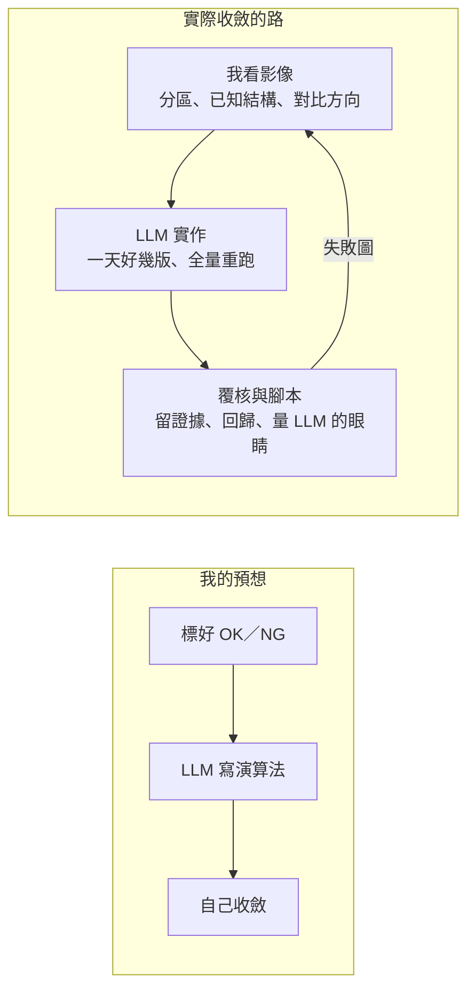

# 09 標註不等於收斂：讓演算法收斂的是我對影像的判斷

> **Summary (EN)**: My starting assumption was that if I labeled images OK or NG, the LLM agent could write the AOI algorithm and converge on its own. I tried it twice. First with 9,000 handwritten cell-level labels as ground truth: after three versions, the miss rate on development plates only went from 0.80 to 0.69, and false rejects on validation plates rose from 0.010 to 0.146; some cells labeled NG showed no visible defect at all. Then with a per-defect review UI I built for myself: it preserved my verdicts, served as a regression set and measured the agent's eyes, but rules the agent derived from my verdicts were replaced within days. What actually made the inspection converge was my own reading of the images: which zones the strip splits into, what is normal in each zone, which bright lines are known structures, and whether a foreign object is darker or brighter than its zone. Labels give answers, not a way of looking at the image. Learning-based detectors such as YOLO learn that way of looking from many labels; a rule-based AOI cannot, so a human with domain knowledge has to supply it. In high-precision inspection, AI is the accelerator and the human keeps the steering wheel.

---

## 背景

這是做完整個專案、回頭看時，我最想修正的一個預想。

前面幾篇講的紀律、覆核介面、看圖初判，都是真實的經驗，也都有用。但如果只能留一句話，我會留這句：

> 產圖覆核在我的開發體感上，並沒有替我收斂太多。真正收斂成功的關鍵，是我觀察影像的分區特徵，指導 LLM 該怎麼做。

## 1. 當時怎麼做：我的預想

我原本以為：**只要把影像標好 OK／NG，LLM 就能寫出 AOI 演算法，自己收斂。**

照這個想法，我做了兩次：

1. **9 月中，用格子標記當真值。** 手上有 9,000 格的手寫標記表，每一格記著 OK 或哪一類 NG。LLM 拿它切開發盤和驗證盤，寫規則、算漏檢與過殺，一版一版迭代。
2. **9 月下旬起，用逐瑕疵覆核。** 我拍板設計、LLM 實作了一套覆核介面，讓我對演算法的每一個候選判「認同／過殺／輪廓不準」，再讓 LLM 從我的判定裡歸納規則，詳見 [05](05_human_in_the_loop.md)。到 10 月下旬，一共出了 36 個覆核包，其中 20 個留下了我的判定檔。

## 2. 出了什麼事

### 格子標記：標的是格子，不是瑕疵

- 三版規則調下來，開發盤的漏檢率只從 0.80 降到 0.69；換到驗證盤，過殺反而從 0.010 升到 0.146。
- 有些標成 NG 的格子，放大 2.5 倍看也找不到任何瑕疵。
- 有些標成 OK 的格子，外觀跟標成 NG 的一模一樣。
- 隔天客戶和我們達成共識：舊的手寫標記表不再當真值。後來要挑範例跟客戶討論時，我也直接說：「我建議你用當前演算法去跑圖，不要靠標記格子。」

那批影像後來因為調光全部作廢，詳見 [06](06_imaging_domain_and_measurement_trust.md)。但就算沒作廢，這條路也走不通：標記告訴 LLM「這格有問題」，沒告訴它「問題在哪、長什麼樣、跟正常的差在哪」。

### 逐瑕疵覆核：留下了判斷，沒有指出方向

- 覆核介面讓我的判斷有了座標和原因，可以跨輪比對，這很有價值。
- 但 LLM 從我的判定裡推出來的規則（例如藍紫色候選的最小面積），不到一週就被我直接訂的一條簡單規則取代：只看大小和形狀，不分底色和顏色。
- 同一段期間，LLM 在細絲檢測上自己選了 6 次方法或規則，0 次留下，詳見 [03](03_method_family_drift.md)。
- 我在覆核裡回答的是「這一條是不是瑕疵」。LLM 真正缺的是「這張圖該怎麼看」，而這個不在任何一個判定檔裡。

### 真正讓它收斂的，是這幾個判斷

| 日期 | 我的判斷 | 背後的影像觀察 | 結果 |
|---|---|---|---|
| 09-24 | 「亮帶就是隔片的邊」 | 那是相對電極穩定出現的產品結構，不是異物 | 當成已知結構建模，成立 |
| 09-27 | 「細絲是獨立輪廓，二值化可分，區分電極邊緣有很多方法」 | 異物和產品結構在形狀上就分得開，不必先把所有細長物抓進來再濾 | 一天七版，開發集召回 29／29 |
| 10-05 | 「用殘差並不合理」「可以接受只抓很明顯的」 | 逐像素扣背景時，參考點是模型不是周圍；模型錯的地方全變成輪廓 | 放棄逐像素背景模型 |
| 10-05～06 | 「不是增加方法而是分區」「分區範圍寫死」 | 試片由上到下分成好幾層，每一層的底色和正常樣子都不同 | 結構寫成固定遮罩、每區各自固定門檻；基準 239 張過殺降到 0，接進機台 |
| 10-06 | 白底只找暗、灰底亮暗都找、黑底只找亮 | 異物在不同底色上的對比方向不同 | 每區只找一種或兩種極性 |
| 10-20 | 「跟附近像素比」 | 某一區的毛比周圍暗，卻不一定比整區門檻暗 | 1,500 張新增 109 條候選，看圖初判幾乎都是真的 |
| 10-24 | 「接近邊界的輪廓加長寬比限制」 | 貼著 ROI 邊的直向細長物，多半是邊線殘影 | 兩批 4,200 張拿掉 51 條過殺，0 條誤拿 |

最後接進機台的細絲檢測，是**最簡單的方法族，加上我給的分區**：已知結構寫成固定遮罩，每一區各自用固定門檻，二值化找獨立輪廓。

## 3. 學到什麼

1. **標註給的是答案，不是看圖的方式。** 規則式 AOI 的核心是「看圖的方式」：這張圖分成哪幾區、每一區正常長什麼樣、哪些是已知結構、異物比背景亮還是暗。這些要由人從影像裡看出來，標記表裡沒有。
2. **「標好資料、讓模型自己學」是學習式模型的路，跟規則式 AOI 完全不同。** YOLO 這類模型會從大量標註裡自己學出看圖的方式。規則式 AOI 沒有這一步；LLM 拿到標註、卻沒有看圖的方式，只能在數值特徵上調門檻去貼合標註，這就是過擬合。十條紀律裡，好幾條其實都在擋這件事。而且我們手上的是格子級的手寫標記，連學習式模型需要的像素級標註都不是。
3. **覆核的角色是驗證，不是導航。** 照收斂順序「定義 → 成像 → 結構 → 判別 → 邊界」來看，覆核在最後一段最有用：留下判斷、當回歸測試、量 LLM 看圖準不準。前面的定義和結構，要靠人對影像的理解。
4. **高精度場域，領域知識不能外包。** AI 是加速器：我一句判斷之後，一天七版、上千張全量重跑、逐張對拍，都是 LLM 做的。但方向盤要在人手上。

## 4. 現在怎麼做

- **開新檢測線，第一件事不是標資料，是我先看圖、把試片分區。** 每一區的底色、正常樣子、會出現哪些已知結構、異物比背景亮還是暗，寫進現況卡的「已確立的物理事實」（範本見 [templates/status_card.md](../templates/status_card.md)）。
- **LLM 依分區先寫最簡單的方法實跑**，失敗圖拿給我看，由我判斷修同族還是換族（[紀律八](../discipline/rules.md#紀律八方法族)）。
- **覆核介面用在後段**：判邊界、留證據、跑範例集回歸、量 LLM 的眼睛。
- **標記表只當線索，不當真值。** 要挑範例，就用當前演算法跑出來的結果，再看圖分級。

## 後來

寫這個作品集時回頭核對紀錄，我發現 [03](03_method_family_drift.md) 把 09-27 的方法族整個寫成「我提的」。其實我說的是「細絲是獨立輪廓，二值化可分」；「先扣背景、再取殘差」是 LLM 對這句話的詮釋，後來就是被我判定不合理、改成分區的那一部分。03 和範本都已更正。**我給的方向和 LLM 的詮釋，要分開記。**

## 限制

- 主要證據來自細絲一條線。點藥、貼合兩條線的定義也大多由客戶和我決定，但沒有做同樣的記分。
- 我沒有實際拿學習式模型做對照。「標註驅動適合學習式模型」是我的判斷，不是這個專案驗證過的。
- 「覆核沒有替我收斂太多」是我的開發體感。覆核留下的判定，確實被用在回歸測試和規則驗證上，也抓到過 LLM 沒看圖就產包。
- 表中的數字都是開發期、內部覆核的結果，不是量產驗收。
