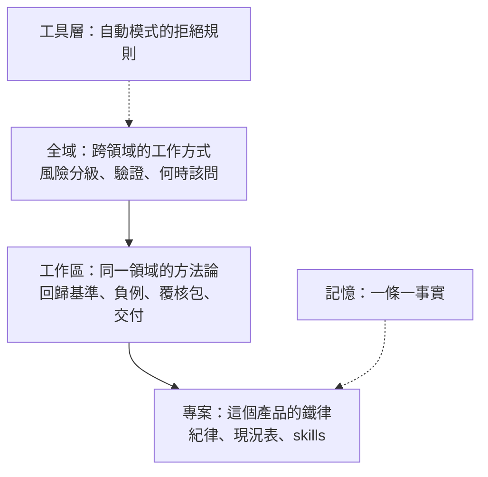

# 10 換了專案還成立嗎：一年 20 多個案子的交叉檢查

> **Summary (EN)**: Notes 01–09 all come from one project. In the same year I used the same coding agents on more than 20 other projects: a four-station inspection machine already running on a customer's production line, 3D and 2D measurement studies, a dozen customer feasibility studies, and a few small tools. I went back through their documents, logs, git history, conversation records and agent memory to check which lessons held elsewhere. Three held up. Convergence came from domain knowledge in at least six different products, and one of them had shown me unreliable labels five months before the main project did. Multi-agent runs were useful for refutation and comparison (an adversarial review vetoed a check that would have switched off hardware-based decisions; an audit found a 74% scale error) and useless for setting direction. And on the production line, the agent's root cause was wrong twice until I asked where the evidence was; the real cause was host stalls corrupting software timestamps, and switching to camera hardware timestamps took simulated errors from 373/6,112 to 0/0. The cross-check also turned up a commit whose message said "add documentation rules" but which changed 501 lines of the main form, and that change surfaced ten months later as a customer complaint. Commit messages, error messages and an agent's "done" are all self-reports; diffs, logs and counter reconciliation are evidence. My rules now live in three layers (global, workspace, project), and every new lesson gets an explicit decision about which layer it belongs to.

---

## 背景

01～09 都來自同一個專案：接手一套電極試片 AOI 機台程式，五個月，從接手到交機。讀者可以合理地問：這些結論是不是只在那個專案成立？

同一年，我用同樣的 coding agent（Claude Code、Codex，更早期也用 GitHub Copilot）做了 20 多個別的案子：

- 一台已經在客戶產線運轉的四站襯套檢測機台：維護、追客訴、逐版交付。
- 量測驗證：3D 線雷射的膠道寬高、保險絲端面的對正。
- 十多個客戶可行性驗證：試片、貼布、瓶內異物、刮痕等。
- 幾個小型軟體：電極檢測工具、少樣本異常檢測網頁台、PLC 通訊模組移植。

寫這個作品集時，我讓代理逐案讀過這些專案的文件、log、git 歷史、對話紀錄與記憶，整理出跨案重複出現的模式。文中公開的關鍵數字，都回到原始 log 或文件核對過。

## 1. 當時怎麼做

前半年（大約 2025 年底到 2026 年春），我把 LLM 當程式產生器：

- 給規格書，請它直接做功能。
- 驗證靠「跑起來、看起來對」。
- 規則只寫在個別專案的指令檔裡，教訓留在那個專案的對話與記憶裡。

## 2. 交叉檢查看到什麼

### 2.1 一個只寫「新增文件」的 commit，十個月後變成客訴

產線機台的 git 歷史裡，有一個 2025 年 11 月的 commit，訊息只寫「新增雙語文件管理規則」。它實際上還改了主表單 501 行，程式碼裡留著「由 GitHub Copilot 產生」的註解。

其中一段改動，把換箱邏輯從「軟體數到一箱就換」改成「先讀 PLC 計數，剛好等於一箱才換，否則默默用 PLC 的數字覆寫軟體計數」。讀 PLC 的時間點，剛好落在最後一顆料正被推出的瞬間，所以偶爾會讀到少一顆。依保留下來的 log 統計，大約每 530 次換箱出錯一次。

2026 年 9 月有一次讀到 99，於是沒換箱，105 顆料被分到檔板已經關上的那一側，客戶就來客訴了。

修法是讓兩邊回到各自的位置：軟體數到就換；PLC 讀值只拿來核對、寫告警，不能否決。改版後的現場 log 裡，298 次換箱核對有 292 次一致，另外 6 次因為輪到時已經太晚而放棄核對，沒有一次少料或超收。

這件事和 [02](02_from_writing_code_to_converging.md) 是同一個教訓：**commit 訊息是自述，diff 才是證據。** 只是這一次，代價是客戶的料。

### 2.2 收斂靠領域知識：至少六個產品都是這樣

[09](09_labels_are_not_convergence.md) 的結論不是單一事件：

| 產品 | 我給的領域判斷 | 結果 |
|---|---|---|
| 試片逐幀影像（4 月） | 「小白點本來就會是，但是太大還是算瑕疵的」 | 改看最大連通面積，門檻由我看分箱網格決定 |
| 只有示意圖規格的試片（7 月） | 指出規格圖上每條距離量的是哪個實體邊界（例如碳印轉角、灰白交界） | 五條距離規則，30 張全對，另外 20 張盲測也全對 |
| 背光貼布（8 月） | 「OK 片大約 500 顆」 | 揭穿既有統計只數「偵測得到的」：缺膠越嚴重越偵測不到，就從統計裡無聲消失。改成以理論格點當分母 |
| 電極檢測工具（2 月） | 規格寫「透過電極看到金色焊盤」 | 改用色彩偵測金色，灰階分不出來 |
| 保險絲端面量測（8～9 月） | 質疑之後促成「直接找凸耳」 | 主線索換成凸耳法線，角度擺動降到 0.13° 以內 |
| 電極試片機台（主專案） | 分區、已知結構 | 見 [09](09_labels_are_not_convergence.md) |

第一列特別值得一提。4 月那個試片案，代理試了十多種特徵，最好的在零誤報下只抓到約 14％ 的瑕疵影格。回頭看圖才發現：標記 OK 的高分影格裡，抽看的 15 張至少三分之一看得到瑕疵；標記瑕疵的低分影格裡，42％ 看起來是乾淨的。標籤是逐樣品標的，不是逐影格標的，所以不能直接當真值。

五個月後，主專案用 9,000 格手寫標記當真值，又失敗了一次（[09](09_labels_are_not_convergence.md)）。**同一個教訓學了兩次，因為第一次只留在那個驗證案的記憶裡，沒有升到上層規則。**

### 2.3 多代理：反證有效，定方向無效

| 用法 | 案子 | 結果 |
|---|---|---|
| 交付前對抗審查 | 產線機台 | 否決一段「執行期時基校驗」：它的觸發門檻剛好選中被停頓撐大的影像，幾次停頓後就會把硬體判定關掉；節拍太快時又永遠完成不了校驗。交付前移除 |
| 六個面向審查＋一個批判者找矛盾 | 3D 膠道量測 | 查出一條管線三層都錯：拼接縫鎖錯、尺度錯了 74％、量法沒對齊客戶定義 |
| 三種實作競賽＋獨立評審 | 背光貼布 | 評審先檢查量尺本身對不對，再比較三個 ROI 方案，選出一個換上 |
| 五個面向的數值分析 | 主專案 | 224 萬 token，被兩張圖推翻（[04](04_two_images_vs_2m_tokens.md)） |

前三列都是「方向已經定了，請代理去推翻或比較」，最後一列是「請代理決定方向」。

74％ 的尺度錯誤其實一算就穿幫：用那個尺度換算，一條掃描線的寬度會超過雷射線本身的寬度。但在審查之前，沒有任何檢核去算這一步。

### 2.4 代理的根因，要附證據

產線機台的客戶反映：樣品編號會錯開一格。

1. **代理第一次歸因**：有人在機台上開了記錄觸發時間的 CSV，檔案被鎖住、寫不進去。我回：「當時有人在機台上開啟或複製 trigger_time 這個 CSV 這幾乎不可能」。
2. **代理第二次歸因**：防毒之類的外部程式把檔案鎖住了，還把這個結論寫進了記憶。我追問：「這件事證據在哪？一定是被外部程式鎖住嗎？而且鎖住如果只鎖 1.4 秒，其實也不太合理」。
3. **重查之後**：錯誤訊息那段文字，證明不了是誰鎖住檔案。真正的原因是主機約 1.4 秒的停頓：相機回呼積壓後一口氣交付，用主機時鐘量到的影像間隔被壓短，真料被誤觸過濾器當成誤觸丟掉。第二、三、四站各丟了一顆，PLC 照樣計數，編號就錯開了。

修法是改用相機在曝光當下打的硬體時間戳。離線模擬 300 個情境、每個 4,000 張影像：

| 判定邏輯 | 該丟卻放行／真料被丟 |
|---|---|
| 主機時鐘（舊） | 373／6,112 |
| 相機硬體時間戳（時間戳全程可用） | 0／0 |
| 相機硬體時間戳（時間戳 0.1％ 讀取失敗） | 19／14 |

新版上機後，9 月 17 日和 21 日兩天的現場 log 裡，共有 24 張影像是「主機時鐘判為過短、相機時鐘判為正常」，照新邏輯放行；舊邏輯會把它們當成誤觸丟掉。錯的歸因也從記憶裡更正了。

量測與檢測案也一樣：代理判「沒有溢錫」，我在圖上畫紅框指出來；代理判「沒有蝕空」，我目視看到白心。

### 2.5 先找錯在哪一層

回頭看，大部分卡關都不是演算法層的問題：

| 案子 | 表面問題 | 真正錯在哪一層 |
|---|---|---|
| 試片逐幀影像 | 特徵分不開 OK／NG | 標籤 |
| 3D 膠道量測 | 量測值不合理 | 尺度與拼接 |
| 背光貼布 | OK 片的盤數偏少 | 分母 |
| 電極檢測工具 | 晶圓拼圖錯位 | 重複圖樣讓「差異最小」的位置變成週期巧合 |
| 產線機台 | 編號錯開一格 | 時間戳的來源 |
| 主專案 | 方法怎麼調都不好 | 定義與取像（[04](04_two_images_vs_2m_tokens.md)） |

這就是 [紀律零](../discipline/rules.md#紀律零開工前四問階段閘門) 在別的案子上的樣子：資料、標籤、尺度、分母、定義任何一層錯，下游調參做的都是負功。

### 2.6 沒做到的地方

- 前半年的幾個驗證案，驗證很弱：同一批調、同一批驗；有的沒有 OK 樣品；比例尺用視野或瓶徑推估，沒用標定板。
- 8 月初一個案子做了負例測試（從無缺陷區切圖跑一遍，證明不誤報），緊接著的兩個案子卻沒延續，直到寫進工作區規範才固定下來。
- 有一個案子用 10 個視覺代理覆核每一筆檢出，但沒有人工對照。代理覆核的結論不等於人工真值。

## 3. 學到什麼

1. **01～09 的主要結論不是單一專案的偶然。** 收斂靠領域知識、多代理不定方向、上游沒收斂不碰下游，在別的產品和別類問題上都重複出現。
2. **多代理的位置在「方向定了之後」**：交付前的對抗審查、方案競賽、找矛盾。要它定方向，五個代理讀同一份前提，只會一起錯。
3. **我的角色是懷疑者。** 代理的根因報告寫得很有說服力，錯的歸因也會寫進記憶。我能做的是問「證據在哪」，並分清楚「訊息的文字」和「成因」。
4. **自述不是證據。** commit 訊息、錯誤訊息、代理說的「已完成」都是自述；diff、log、計數器對帳才是證據。
5. **監控通道不能拿控制權。** 用來核對的讀值，只能告警，不能否決主流程。
6. **教訓要升層。** 同一個教訓學兩次，是因為第一次只留在單一專案的記憶裡。

## 4. 現在怎麼做

### 規則分三層，每個新教訓先決定放哪一層

這三層是一層一層長出來的：

| 時間 | 層 | 內容 | 起因 |
|---|---|---|---|
| 2026-02 | 專案 | 第一條護欄：少樣本異常檢測工具「禁止改寫成監督式分類器」 | 防止代理順手把設計改掉 |
| 2026-06 | 全域 | 依風險分兩種執行模式、何時該問何時自決、沒實跑的測試不准說通過、不做無聲的破壞性操作 | 前半年的經驗 |
| 2026-08 | 工作區 | 特徵凍結當回歸基準、改架構前凍結舊版、負例測試、覆核包、定版文件必寫已知限制與失效方向 | 8 月幾個驗證案的做法 |
| 2026-09 | 全域、工作區 | Codex 讀同一套規則 | 開始雙代理 |
| 2026-09～10 | 專案 | 迭代紀律零＋九條、雙代理協定、授權語義（[02](02_from_writing_code_to_converging.md)、[07](07_knowledge_architecture.md)） | 每一版對應一次失敗 |
| 2026-09 | 工具 | 自動模式的兩條拒絕規則：禁止 reset／clean、禁止跳過部署備份 | 只靠代理自律不夠 |

新教訓先問三個問題：只有這個產品適用？同一領域都適用？還是跨領域都適用？答案決定寫進專案、工作區或全域。

### 其他固定做法

- **根因報告分開寫「證據」和「推測」。** 錯的歸因被更正時，記憶一起改。
- **多代理只排在兩個位置**：交付前的對抗審查，以及方案競賽。方向由我在影像上定。
- **交付可回退。** 每個交付版保留原樣執行檔、雜湊值、來源 commit 和回退步驟，啟動 log 寫版本字串。起因是我要求「確認我有辦法回復，才建置」。
- **讀 commit 看 diff，不看訊息。** 接手或追查時，以實際改動為準。

## 後來

這篇本身就是一次「升層」：把散在 20 多個專案記憶裡的教訓，整理成可以跨案引用的一份。

## 限制

- 這些案子大多是驗證案：樣本內、小樣本。文中數字是開發期的內部結果，不是量產驗收。
- 產線機台不是我從零打造的，接手時已在客戶產線運轉。主機停頓本身的成因還沒找到。
- 多代理的正例只有幾個，只能說「在這些案子裡有效」，不是普遍統計。
- 這篇的素材由代理逐案讀檔整理，公開的關鍵數字回原始紀錄核對過；其餘以原專案紀錄為準。
- 仍然是一個人加幾個代理的經驗，沒有在團隊裡驗證過。
